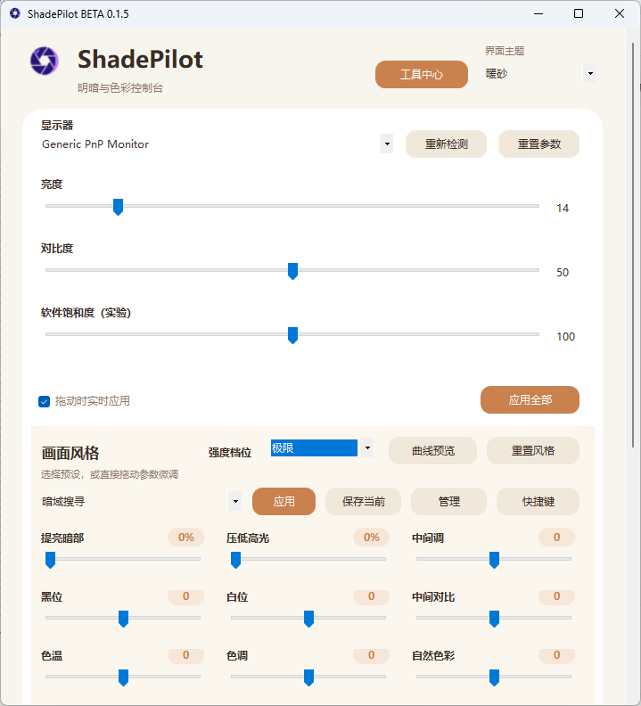
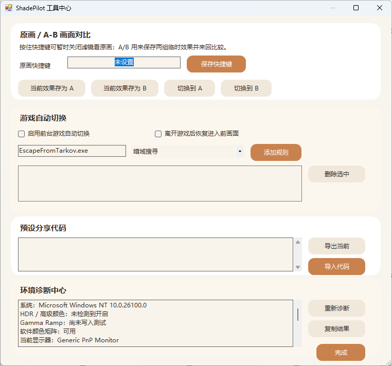
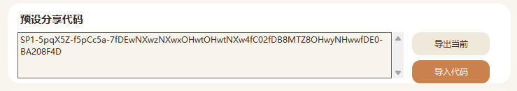

# ShadePilot

[English](README.md) · [简体中文](README.zh-CN.md)

ShadePilot is a lightweight Windows display and color-control utility. It brings monitor hardware controls, software picture styles, presets, and safe recovery into one desktop application without injecting into games or creating an in-game overlay.

> Current version: \`BETA 0.4.5\`
> Platform: Windows 10/11

## Screenshots and overview

### Shadow lift and highlight control

The image is an offline simulation of ShadePilot's style controls. Actual results depend on the monitor, HDR state, Windows color settings, and panel characteristics.

### Main display controls

Hardware brightness and contrast, software saturation, picture styles, tone controls, presets, and recovery actions are available from the same application.

### Tools center and game switching

The Tools Center provides original-image toggle, A/B comparison, foreground-game switching, preset sharing, environment diagnostics, and background hotkeys.

### Preset share code

Export or import a complete picture preset as a single share code.

## Key features

- Enumerates physical displays and detects supported brightness, contrast, color, and DDC/CI capabilities.
- Uses standard Windows \`Dxva2.dll\` APIs for supported monitor controls.
- Provides live tone curves, picture styles, custom presets, and a simple adjustment mode for brightness, dark areas, clarity, tonal depth, color, and temperature.
- Exports a standard 33-point \`.cube\` 3D LUT for the OBS Apply LUT filter.
- Includes a game performance protection mode that pauses Windows software color transforms and display re-detection while a foreground fullscreen application is running.
- Restores missing built-in presets without overwriting user presets.
- Supports global hotkeys, the system tray, per-display settings, and multi-display style synchronization.
- Records the display state at session start and restores it on normal exit or after a dirty session is detected.

ShadePilot does not inspect game processes, inject DLLs, create game overlays, capture the screen, simulate input, or connect to the network. It uses Windows display configuration APIs.

## Install and run

1. Download \`ShadePilot-BETA-0.4.5-win-x64.zip\` from [Releases](https://github.com/BYS-XSQ/ShadePilot/releases).
2. Extract the archive and run \`ShadePilot.Wpf.exe\`.
3. If monitor capabilities are not detected, enable DDC/CI in the monitor's on-screen menu.

The package is framework-dependent and requires the .NET 8 Windows Desktop Runtime. The test build is not commercially code-signed, so Windows may show an unknown-publisher warning. Download releases only from this repository and verify the SHA-256 hash when distributing a build.

### Use a LUT in OBS

1. In ShadePilot, choose **Export LUT** in the picture-style toolbar.
2. In OBS, add the **Apply LUT** filter to the game capture source or scene.
3. Select the exported \`.cube\` file and set the filter strength to 100%.

The LUT contains picture-style curves, exposure, temperature, tint, and saturation intent. Monitor backlight and hardware contrast cannot be reproduced by an OBS post-process LUT and are therefore not written into the file. Use it as part of an SDR workflow.

## Safety and recovery

- The application records readable monitor parameters and the original Gamma state at session start.
- **Reset parameters** and **Reset style** restore hardware controls and picture curves independently.
- **Restore on exit** is enabled by default for a normal window close.
- Power loss, system crashes, and forced termination may prevent an immediate shutdown restore. On the next launch, ShadePilot uses its persistent recovery state to restore the previous session baseline when possible.

## Compatibility and known limitations

- External monitors must support and have DDC/CI enabled; built-in panels, docks, KVMs, and adapters may not expose these controls.
- MCCS/VCP behavior differs between vendors. Some controls may be unavailable or may not report a reliable read-back value.
- Gamma adjustment affects the SDR desktop and may be ineffective or behave differently in HDR mode.
- ShadePilot does not automatically determine whether a preset is suitable for a particular monitor. Adjust gradually and keep the recovery options available.
- Driver-level sharpening/IGCL write support is not included in this release.

## Privacy

ShadePilot does not connect to the network and contains no accounts, telemetry, or advertising SDKs. Settings are stored under \`%LOCALAPPDATA%\\DisplayPresetPrototype\\\`.

## Build from source

\`\`\`powershell
dotnet publish .\wpf\ShadePilot.Wpf.csproj -c Release -r win-x64 --self-contained false
\`\`\`

The legacy \`build.ps1\` script still builds the classic WinForms target. The current desktop release is the WPF target under \`wpf\\\`.

## Feedback

When reporting a bug, include the ShadePilot version, Windows version, monitor model, connection path, DDC/CI status, reproduction steps, and the exact error message.

- [Report an issue](https://github.com/BYS-XSQ/ShadePilot/issues)
- [Contributing guide](CONTRIBUTING.md)
- [Security policy](SECURITY.md)

## License

The source code is available under the [MIT License](LICENSE). The ShadePilot name, logo, and brand assets are not included in the MIT license and may not be used to imply an official build or partnership without permission.
